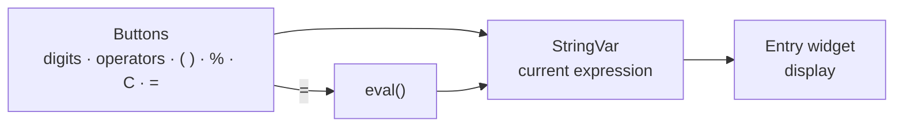
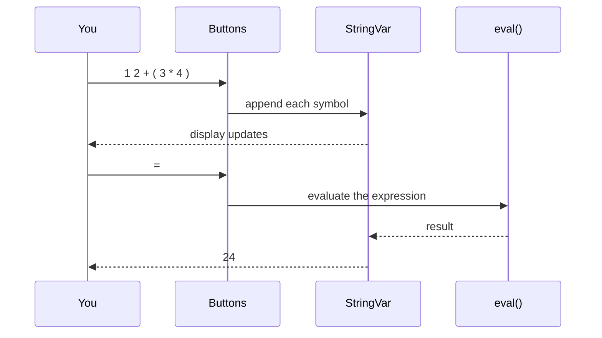

# GUI Calculator

**A Tkinter calculator — digits, operators, parentheses, percentages and decimals in one small window.**

[](Calculator.py)
[](Calculator.py)
[](Calculator.py)

A first GUI project: a fixed 357 × 420 window, a display bound to a `StringVar`,
and a grid of buttons that build an expression for Python to evaluate.

---

## Contents

| Section | |
|---|---|
| [What it does](#what-it-does) | The features |
| [Architecture](#architecture) | Window, display, buttons, evaluation |
| [How a calculation runs](#how-a-calculation-runs) | Press, build, evaluate |
| [Quick start](#quick-start) | One command |
| [Project status](#project-status) | Scope and limitations |
| [Design decisions](#design-decisions) | The tradeoffs, and why |
| [Team](#team) | Who built it |

---

## What it does

| Area | Capabilities |
|---|---|
| **Arithmetic** | Addition, subtraction, multiplication, division and percentages |
| **Grouping** | Parentheses for order of operations |
| **Input** | Decimals and zero, entered by button |
| **Controls** | Clear resets the input; `=` evaluates it |
| **Display** | Updates live as each button is pressed |

---

## Architecture



The window, its title and colours are configured on the root; buttons are
positioned with `place()`.

---

## How a calculation runs



---

## Quick start

```bash
python Calculator.py
```

Python 3 with Tkinter (bundled with most Python installs). No other dependencies.

---

## Project status

Complete as a first GUI project.

| Limitation | Detail |
|---|---|
| `eval()` | Safe here only because input comes from buttons; it would be dangerous on free-typed input |
| Basic operations only | No square roots, exponents or other functions |

---

## Design decisions

**Let Python do the arithmetic.** Building the expression as a string and handing
it to `eval()` gives correct precedence and parentheses for free — acceptable
because the only input path is the button grid.

**One `StringVar` as the source of truth.** The display is bound to it, so every
button only has to update one value.

---

## Team

| Member | Focus |
|---|---|
| **Guru R Bharadwaj** | The whole thing |
